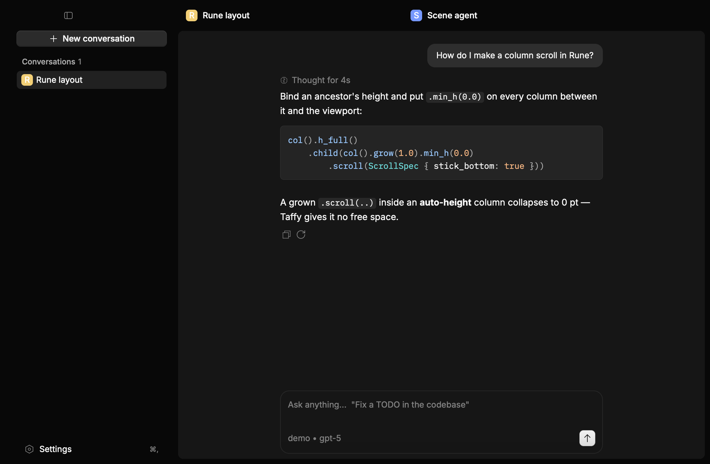
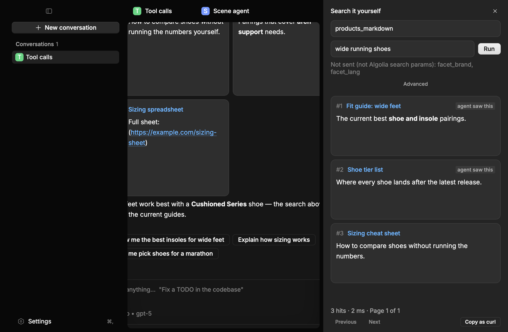
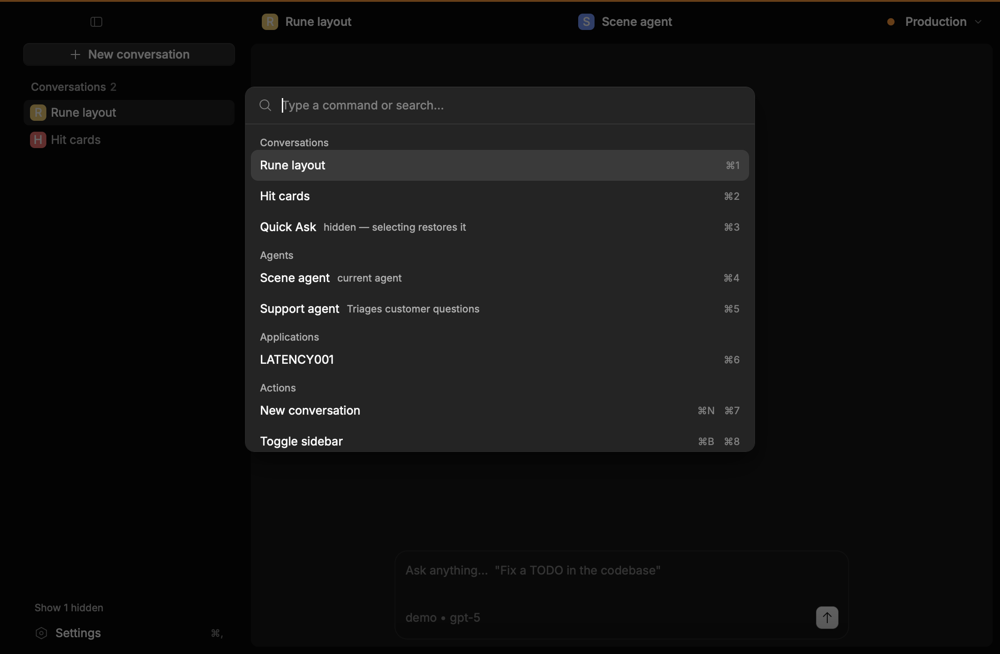

# as-gui

A desktop chat client for [Algolia Agent Studio](https://www.algolia.com/doc/guides/algolia-ai/agent-studio) agents. Agent Studio hosts LLM agents that search your Algolia indices and call tools. as-gui lets you talk to those agents from a native macOS app, see which tools they called and what the search returned, and re-run their searches yourself.

It is written in Rust on the [Rune](https://github.com/anomalyco/rune) UI framework.



## Features

- Streaming replies with markdown, copy, retry and thumbs up or down.
- Tool calls shown with their JSON input and output, and a timeline of how long each step took.
- Search hits as cards. Click one to read the whole record.
- "Search it yourself": re-run an agent's query against the index, edit its parameters, and copy it as a curl command.
- Several Algolia applications, each with its own color, and a command bar (⌘K) for switching agents, applications and conversations.
- Quick Ask, a launcher panel for one-off questions (⌘⇧Space), and Ask about selection (⌘⇧A), which quotes the text selected in the app in front.
- A menu bar icon, and a notification when a reply finishes while the app is in the background.
- Light and dark themes, accent colors, and rebindable shortcuts.

| Search it yourself | Command bar |
| --- | --- |
|  |  |

## Requirements

- macOS 12 or later. The prebuilt app is for Apple Silicon.
- An Algolia application with Agent Studio enabled and at least one published agent.
- A search API key for that application with the `search`, `settings` and `logs` ACLs. `settings` lets the app list agents, `logs` lets it list past conversations, and `search` runs queries. Do not use your admin API key.

## Install

Download the `.dmg` from the latest [GitHub release](https://github.com/8bittitan/as-gui/releases) and drag **Agent Studio GUI** to Applications.

Each release has a `SHA256SUMS` file. To check the download, run this in the folder holding both files:

```sh
shasum -a 256 -c SHA256SUMS
```

The app is signed ad hoc and is not notarized, so macOS blocks the first launch. Open System Settings, go to Privacy & Security and choose **Open Anyway**, or run:

```sh
xattr -dr com.apple.quarantine "/Applications/Agent Studio GUI.app"
```

## Build from source

The easiest way to get the tools is [mise](https://mise.jdx.dev). From the repository root:

```sh
mise install             # installs the pinned Rust toolchain and just from mise.toml
```

Without mise, install [rustup](https://rustup.rs) and [just](https://github.com/casey/just) yourself. rustup reads `rust-toolchain.toml` and installs the pinned toolchain on the first build. just is optional, but it runs the project's tasks.

Then build and run:

```sh
cargo run                # debug build with the live tuning panel
just build               # release build without the tuning panel
just bundle              # target/bundle/Agent Studio GUI.app
```

The first build fetches Rune from GitHub, which takes a while. To try the app without an Algolia account, run a debug build with `AS_GUI_MOCK=1 cargo run`, which talks to a built-in mock agent.

## Using it

On first launch the app asks for your Application ID and search API key. Add more applications later from the switcher in the header.

On macOS the app starts in the menu bar. Open the window from the icon, or turn on "Open the window at launch" in Settings.

| Shortcut | Action |
| --- | --- |
| ⌘K | Command bar |
| ⌘N | New conversation |
| ⌘B | Toggle the sidebar |
| ⌘, | Settings |
| ⌘⇧Space | Quick Ask |
| ⌘⇧A | Ask about selection |

Every shortcut can be changed in Settings under Keyboard shortcuts.

### Ask about selection

⌘⇧A opens Quick Ask with the text selected in the app in front quoted above the field. Select, press ⌘⇧A, press Return, and the agent explains it.

To read the selection, the app sends that app ⌘C and then puts your clipboard back. macOS allows that only with Accessibility access. Settings shows whether it is granted, and **Grant access…** asks for it. Without it, the panel quotes your clipboard text instead, unless the app that copied it marked it as secret, as password managers do. The quoted text goes to the agent only when you ask.

The ad-hoc signature changes with every build, so macOS may forget the permission after an update. Remove **Agent Studio GUI** from the Accessibility list and grant it again.

### Notifications

When a reply takes more than a few seconds and finishes while the app is not in front, macOS shows a notification with the agent's name and the first line of the reply. Clicking it opens that conversation. A failed turn shows "Couldn't finish: …" the same way. Turn it off in Settings under Notifications. Only the bundled app can post notifications, so a `cargo run` build stays quiet.

## Privacy

- Your API key is stored as plain text in `~/Library/Application Support/com.8bittitan.as-gui/state.json`. The file and its folder are readable only by your user.
- The app talks only to your application's Algolia hosts, `https://<app id>.algolia.net` and `https://<app id>-dsn.algolia.net`. It sends no analytics.
- Logs are in `~/Library/Logs/com.8bittitan.as-gui/`. They hold request URLs, event types and errors, never your API key or the text of messages. `LOG_LEVEL` sets the level (`warn` by default).

## Contributing

See [CONTRIBUTING.md](CONTRIBUTING.md) for the development workflow and [ARCHITECTURE.md](ARCHITECTURE.md) for how the code is laid out. To report a security problem, read [SECURITY.md](SECURITY.md).

## License

[MIT](LICENSE)
